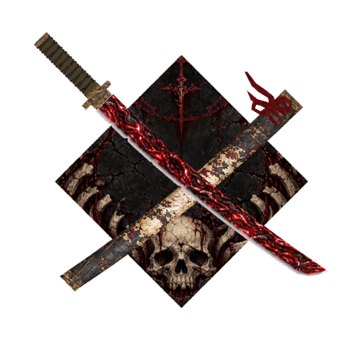

# EldenBlade — 尸山血海

Minecraft **1.20.1 Forge**／**拔刀剑重锋**附属模组，版本 **1.2.0**。

通用生命值识别的实现与测试范围见 [1.2.0 更新记录](docs/RELEASE_1.2.0.md)。

## 下载与安装

[下载 EldenBlade 1.2.0](releases/EldenBlade-1.20.1-1.2.0.jar)。SHA256 校验文件位于同一目录。

需要 Java 17、Forge 47.3.22 或兼容的更高 47.x，以及拔刀剑重锋。开发验证涉及重锋 1.1.23 和 1.8.62，其他版本未承诺兼容。用新 JAR 替换旧版；多人游戏客户端与服务器均安装。

## 武器与技能

- 默认基础攻击 24，耐久 779，锋利／抢夺／力量／火焰附加／耐久均为 X。
- SA「尸横遍野」：前方 7×7×7，两段交叉连击，间隔 5 tick（20 TPS 时 0.25 秒）。每段 250% 玩家攻击属性伤害，额外扣目标最大生命的 10%。以持刀位置前方 0.8 格为枢轴的倾斜扇形血光逐段展开并消散。
- SE「鲜血的祝福」：默认 10% 概率额外扣目标最大生命的 10%，玩家全局冷却 2 tick。SA 可触发 SE，SE 不递归。
- 百分比扣血追踪目标 `getHealth()` 实际读取的同步字段，支持原版和可识别的自定义 Float 同步血量。来源不明确时停止额外扣血并限频记录日志；不会锁血或禁止正常回血。
- 管理员可用 `/eldenblade health <目标选择器>` 只读查看服务端生命值与识别状态。
- 基础攻击、SA 百分比、SE 概率／百分比／冷却支持存档服务器配置与管理员指令，见 [配置说明](docs/CONFIGURATION.md)。
- 鼠标悬停尸山血海并按住 **Shift** 时，以鲜红色显示老翁的武器描述。松开 Shift 后隐藏。

## 合成

| 耀偏方三八面魂 | 下界之星 | 耀魂结晶 |
|---|---|---|
| 魔剑「阎魔刀」 | 回响碎片 | 无铭刀「木偶」 |
| 耀魂宝珠 | 龙蛋 | 耀魂铁锭 |

阎魔刀至少 200 击杀／10 锻造／5000 耀魂，木偶至少 20／5／2000。材料消耗并继承相应数据。旧刀的默认耐久／附魔不自动迁移；获取新刀可使用 `/eldenblade give`。

## 外观与性能

刀与鞘合计 1,578 三角面，单张 2048×2048 图集；完整／破损／无鞘物品栏图标为 66／60／44 面。图标保持刀柄左上、刀尖右下、反向交叉刀鞘及尸骨祭坛背景。

SA 每道血光包含 192 面的扇形主体和 16 面的小血丝，两道合计最多 416 面，共用一张带透明通道的纹理。每道存活 12 tick，无附加粒子阵列或动态灯光，不产生额外攻击判定。



预览是模型离线渲染，蓝色耐久框由重锋绘制。面数不是 FPS 测试结果。

## 构建

安装 JDK 17 并配置 JAVA_HOME，按 [依赖说明](libs/README.md) 放入本地重锋 JAR，然后执行：

```powershell
.\gradlew.bat build
```

首次构建需要联网下载 Gradle／Forge 依赖；缓存完整后可加 `--offline`。输出在 `build/libs/`。本仓库包含可构建源码及成品 OBJ／PNG，不分发第三方依赖、参考模组、用户存档或本机 Blender 历史工程。

## 文档与验证范围

- [完整开发工作流](拔刀剑附属MOD开发工作流.md)
- [外观重制任务书与历史记录](外观重制任务书.md)
- [1.0.0 发布检查](docs/RELEASE_1.0.0.md)
- [功能测试记录](docs/TESTING.md)

百分比扣血对已测试实体的部分限伤有效；独立血量、特殊阶段、复活及掉落机制仍需逐项适配，不能视为所有 Boss 全阶段无条件兼容。完整整合包客户端的新提示视觉、模型动画及帧时间仍待实机验收。

源码、资源和素材来源说明见 [来源记录](docs/ASSET_SOURCES.md)。当前许可声明为 All Rights Reserved；公开仓库不代表授予第三方素材的再分发权。
