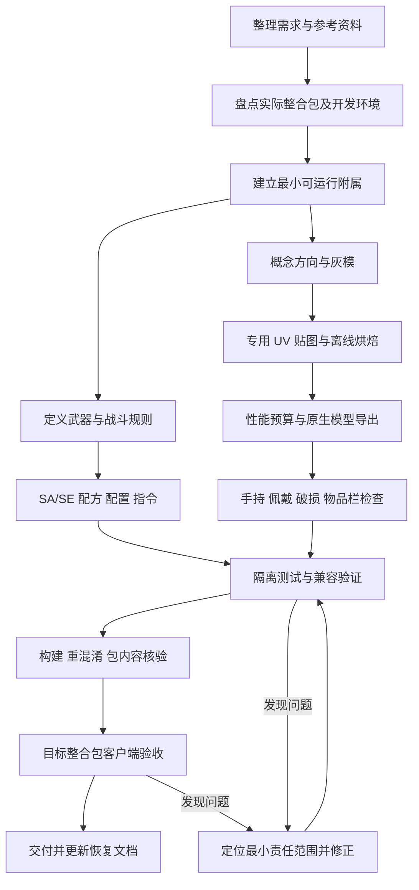

# 拔刀剑附属 MOD 开发工作流

整理日期：2026-10-19。案例项目：EldenBlade／尸山血海，整理案例涵盖至 0.4.4-alpha；当前交付为 1.0.0。

本文将本次从需求、参考图、模型制作、战斗开发到兼容修复与交付的过程整理为可复用流程。平台案例为 Minecraft 1.20.1、Forge、拔刀剑重锋；其他版本应重新检查 API、资源格式和加载器要求，不能直接套用版本号。

这是操作手册，不是新的功能需求，也不是所有项目已通过的验收报告。尸山血海的当前美术与恢复入口另见 [外观重制任务书](外观重制任务书.md)；历史测试证据见 [测试记录](docs/TESTING.md)。

## 1. 总体流程与推进原则



推荐按此顺序组织下一把刀；它不是对本项目开发时间线的机械复述。先验证最小附属能运行、占位模型的握点正确，再投入精细美术，可以减少后期返工。

每个阶段记录四项：输入、操作、产物、验收结果。凡是“通过”，应能指出对应日志、检查结果或实机记录。未执行的项目写“未验证”，不要用“应该可以”替代。

用户已经授权开发后，持续完成范围内的实现和验证；不把每个阶段都变成重复询问许可。只有缺失的信息会实质改变结果，或用户明确要求先看方案时，才在相关环节等待选择。

## 2. 阶段一：把构思整理成可执行规格

### 2.1 收集输入

收集目标 Minecraft、加载器、拔刀剑分支与版本、目标整合包位置、参考图、希望参考的其他刀以及开发工具位置。参考资料分别标注：

| 资料 | 用途 | 不能替代什么 |
|---|---|---|
| 原作截图 | 刃口朝向、刀尖、弧度、颜色、装具结构 | 可编辑三维模型 |
| 用户认可的概念图 | 确定整体造型与材质方向 | 已完成的游戏资源 |
| MC 玩家佩戴截图 | 比例、握点、佩戴位置、穿插参考 | 刀面细节图 |
| 物品栏截图 | 方向、交叉姿势、居中和缩小后的辨识度 | 手持模型尺寸规则 |
| 本地参考模组 JAR | 实际分组、面数、贴图与渲染方式 | 可直接复制发布的素材授权 |

参考图片复制到项目的 `art/reference/`，用有意义的名称保存。不要让工程长期依赖聊天附件的临时路径。素材来源、生成提示词和使用范围记录在 `art/SOURCES.md`。

### 2.2 先明确容易歧义的数值

逐项定义基础攻击、玩家最终攻击属性、耐久、附魔、配方、SA、SE，以及默认值与可调范围。

特别要回答：百分比按最大生命还是当前生命计算？是额外扣当前生命还是降低最大生命？攻击范围在玩家前方还是以玩家为中心？两段间隔多长？最大生命是否快照？SA 能否触发 SE？冷却归玩家还是归目标？多部位 Boss 是否去重？

本项目规则示例：

- 默认基础攻击 24；最终玩家攻击属性不能简单视为固定 24。
- SA 前方宽、高、深各 7 格，两段相隔 3 tick。每段普通伤害为释放时玩家攻击属性的 150%，另扣目标最大生命的 10%。
- 该次 SA 的百分比参数在释放时固定；目标最大生命在本次 SA 首次命中该目标时固定。两者是不同的快照。
- SE 默认 10% 概率、10% 最大生命伤害、2 tick 玩家全局冷却；SA 可以触发，SE 不递归。正常 20 TPS 下 2 tick 为 0.1 秒，低 TPS 时实际秒数会延长。
- 每段按逻辑目标去重；尸体、无效对象、PvP 与队友规则要有明确处理。

### 2.3 建立持久任务书

根目录保留一份任务书，写清已确认要求、当前主工程、已完成状态、剩余验证和下一步。用户每次修改比例或方向，记录“相对哪个版本”，避免连续调整时基准丢失。

**阶段产物：**需求规格、参考图目录、任务书。

**通过条件：**实现者能据此写出伤害公式、范围边界和模型方向，不需要猜测关键规则。

## 3. 阶段二：盘点环境与真实兼容基线

### 3.1 检查实际文件

读取目标整合包的加载器版本、`mods`、模组元数据、配置及相关脚本。建立兼容矩阵，不只记录“MC 都是 1.20.1”。

本项目已观察到的差异：

| 项目 | 实际情况及意义 |
|---|---|
| 拔刀剑重锋 | 勇者之章使用 1.8.62，落幕曲使用 1.1.23；需要核对两版 API |
| Forge | 落幕曲实际为 47.3.22；首版要求至少 47.4 导致代码加载前退出 |
| Boss 模组 | 同名模组存在不同版本，配置和扩展 Mixin 也不同 |
| Java | 本项目使用 JDK 17；系统默认 Java 不能代替项目 Java 检查 |

依赖声明的最低版本应由实际 API 使用和运行验证支持。不能只把 `mods.toml` 的范围改宽，就宣称兼容。

### 3.2 本项目可用工具

| 工具或目录 | 路径／用途 |
|---|---|
| 项目根目录 | `<PROJECT_ROOT>` |
| JDK 17 | `<JDK17_HOME>` |
| Gradle | 项目 `gradlew.bat`，现有 Wrapper 8.8 |
| Gradle 缓存 | `<USER_HOME>/.gradle` |
| Blender | `<BLENDER_EXE>`；本次实际使用 5.2.2 LTS |
| Python | 文档整理、包检查等标准库脚本；Blender 脚本使用 Blender 自带 Python |
| 本地依赖 | `libs/`，只供开发研究，不随成品打包 |
| 本地调查证据 | `docs/research/`，包括 API、字节码和配置记录 |

不要默认外部 Python 已装 Pillow、NumPy；也不要默认它拥有 `bpy`。本项目模型脚本由 Blender 执行，图集操作使用其图像缓冲和随附环境。

### 3.3 先做最小可运行附属

建立 Forge 工程、模组元数据、命名空间、资源目录与依赖；注册一把可通过指令获取的占位刀，验证专用服务器能加载、客户端能看到占位模型。客户端渲染类不要无条件进入服务器加载路径。

**阶段产物：**兼容矩阵、最小源码、环境记录、首个运行证据。

**通过条件：**最低目标环境能加载，并且证据来自实际目标版本，而非仅来自较新的开发环境。

## 4. 阶段三：设计图、灰模与游戏比例

### 4.1 从概念图拆出结构

把造型分为刀身与磨刃、刀背、刀尖、刀柄、缠带、刀镡、装具、刀鞘、鞘口、绳结和垂带。分别确定：

- 轮廓必须由几何表达的部分，如刀尖、弧度、较大的刃口缺损、刀镡与绳结外形。
- 可由贴图表达的部分，如血纹、雕花、裂纹、磨损与微小划痕。
- 仅在离线制作中保留的高细节来源，如细绳散线和浮雕。

概念图的高光、血纹立体感和雕刻不会自动成为模型。精细度依靠正确结构、专用 UV、明暗与纹理组织，不能用增加截面数量代替。

### 4.2 灰模优先确认五件事

1. 刃口在哪一侧；同时检查两面及最终导出坐标。
2. 刀尖是否与参考一致，避免把单刃上挑尖做成对称矛尖。
3. 刀、柄、鞘的相对尺寸与曲线是否合理。
4. 握点、佩戴原点和动画轴是否正确。
5. 玩家比例下是否太细、太短或明显穿模。

本项目约定：刀刃为模型局部 +Y，长度沿 X；完整刀长为 363.125 原模型单位。这个数字来自此前 1.25 倍加长再乘 7/8，不能当成其他刀的固定标准。

Blender 展示用父级旋转、灯光和摆放不应误烘进游戏坐标。本项目导出使用模型局部坐标，展示场景与游戏坐标分开处理。

**阶段产物：**可编辑灰模、全貌、侧面、刀尖和握柄近景。

**通过条件：**主轮廓、方向、原点和尺寸成立，再推进精细贴图。不要在轮廓错误时先堆雕花。

## 5. 阶段四：专用 UV、材质与烘焙

### 5.1 先安排 UV 再制作贴图

刀面、刃口、刀背、刀鞘纵向区域、柄部、金属装具与布带应有明确对应关系。可镜像复用的区域与需要独立表现的区域分别记录。

先用棋盘格检查拉伸、接缝、端盖与比例，再使用正式颜色。刀鞘“中段泛白、两端偏黑”要沿长度组织，而不是在整条鞘上均匀铺白噪声。

生成式图像可用于概念方向或专用贴图素材，但应基于明确布局；其输出尺寸必须实测。本项目某绘制源实际为 1254×1254，不能因模板是 2048×2048 就声称源图也有 2048 分辨率。

### 5.2 将材质意图落到游戏可用资源

红白过渡应有血色浸染、露钢宽窄变化，而不是两块材质的直线边界。先在制作材质中调好，再烘焙到游戏使用的颜色图集。

少量大缺口保留真实几何；细划痕、血纹和雕刻主要使用贴图。缺口不等距、不等深，避免成为规则锯片。

本项目以单张 2048×2048 图集为目标。复杂噪声、混合节点、工作室金属高光仅属于制作过程，不能假定重锋原生渲染会自动实现 Blender 的 PBR 效果。

### 5.3 烘焙检查顺序

1. 保留可编辑材质工程，再另存烘焙版。
2. 为烘焙建立 GameUV，检查边界、退化面和图块间距。
3. 核对端盖 UV，防止它覆盖长条主体图块。
4. 只绑定最终图集重新渲染，确认细节确实来自贴图。
5. 检查全貌、刀尖、刃口、刀柄和鞘口；同时看缩小后的表现。
6. 内嵌需要随工程移动的贴图，并记录来源。

**阶段产物：**源 UV／素材、材质工程、烘焙图集、单材质模型预览。

**通过条件：**单图集版本能保留主要外观；不依赖未导出的材质节点或隐藏高模。

## 6. 阶段五：按实际参考设性能预算

### 6.1 统一统计口径

读取参考 OBJ 的分组和贴图尺寸；以三角面计数，四边面按两个三角面换算。使用应用修改器后的网格统计，不能漏掉厚度、倒角或细节对象。

区分刀体、刀鞘、破损刀、物品栏、发光分组与制作来源。互斥状态不能简单相加为“每帧开销”，也不能把参考文件中的备用 handle 分组无条件加入正常手持绘制。

本项目依据本地柯罗诺斯「永境之主」资源和重锋绘制路径，建立以下预算：

| 分组 | 参考上限 | 当前尸山血海 |
|---|---:|---:|
| blade，含柄和刀镡 | 1,175 | 1,166 |
| sheath，含绳结 | 413 | 412 |
| blade_damaged | 1,062 | 898 |
| item_blade | 117 | 66 |
| item_damaged | 110 | 60 |
| item_bladens | 92 | 44 |

以上是本项目预算，不是所有拔刀剑的通用上限。详细依据见 [性能比较报告](docs/material_v4/README.md)。

### 6.2 优化优先级

先移除看不到的内部结构和制作专用高模，再减少平顺区段采样，把面数留给刀尖、缺口、刀镡轮廓和可见缠绕。不能只对整个模型执行统一比例减面。

本次压平柄部缠带的试验损失了交叉形状，最终改为减少平顺刀身的截面，把面数重新分配给立体缠带。刀鞘保留短内壁和开口，移除不可见长内管。

同时检查材质数量、贴图尺寸、发光层、透明区域、OBJ 重复索引和加载数据。复用位置／UV／法线索引可降低文件冗余，但实际内存仍需运行测量。

单张 2048×2048 RGBA8 基础层未压缩容量约 16 MiB，完整 mipmap 链估算约 21.33 MiB；PNG 压缩文件大小不是显存大小。附魔闪光可能重复提交几何，SA 实体、粒子和服务器结算另有成本。

**阶段产物：**分组预算、优化模型、机器统计与前后预览。

**通过条件：**逐组达标、轮廓仍可辨认。面数减少不能写成同比例 FPS 提升；客户端帧时间应在同场景另测。

## 7. 阶段六：原生分组与物品栏独立设计

### 7.1 原生导出

核对目标重锋版本实际读取的分组。按需要导出完整刀、刀鞘、破损刀、三个物品栏状态，以及可选碎片、特效和发光分组。参考渲染器的读取行为，不凭分组名称猜测它一定被绘制。

导出后检查 OBJ 索引、法线、坐标、UV、空分组处理、纹理路径与命名刀定义一致性。检查持握原点、尺度及破损状态，而不只查看整张展示图。

### 7.2 物品栏另设构图

物品栏允许独立控制长度、宽度、旋转、深度、居中和背景；这些参数不应自动改变世界手持模型。

本项目通过离线渲染实际模型，将图标烘到同一图集，按透明轮廓生成低面数平面。必须裁掉透明方角：重锋独立附魔闪光层不能简单假定会按颜色图集透明度遮罩，完整矩形底板可能出现方块闪光。图标没有实时立体视差，这是一项明确取舍。

本项目当前图标约定：

- 刀柄左上、刀尖右下，刀在鞘前方；鞘口右上、鞘尾左下。
- 刀鞘弧线向右下凸，不是左上凸。通过调整中心线修正，不镜像整张材质和装饰。
- 保留 B 尸骨祭坛背景；蓝色耐久框由重锋绘制，不重复烘入图标。
- 完整刀与鞘按各自包围盒居中，再调整刀的位置；破损状态保持完整状态的柄端锚点。
- 宽度围绕弯曲中心线调整，避免把加粗误做成增加弧度。

连续比例修改要保留公式：刀面系数 2.1 → ×2/3 = 1.4 → ×5/4 = 1.75；刀鞘 1.85 → ×5/6 ≈ 1.5416667。最终不是把“5/4”重新应用到最早原模。

**阶段产物：**完整原生资源、各状态图标、当前参数表。

**通过条件：**方向和姿势符合参考、缩小可读、背景层级正确；仅调图标时，世界分组与世界贴图区域应可证明未变。

## 8. 阶段七：实现武器、SA、SE 与配方

### 8.1 用职责分离控制复杂度

本项目源码入口均在 `src/main/java/dev/kunas/eldenblade/`：

| 文件 | 主要职责 |
|---|---|
| EldenBlade.java | 模组入口与注册组织 |
| BloodCombat.java | 两段 SA、SE 概率、冷却及命中流程 |
| HitVolume.java | 前方定向命中范围 |
| BloodDamage.java | 独立百分比生命扣除与归属／死亡处理 |
| BossCompatibility.java | 具体实体兼容处理 |
| BloodBladeRecipe.java | 材料刀条件与输出继承 |
| BladeConfig.java | 服务器配置与运行参数 |
| BladeBalance.java | 基础攻击力同步与单刀覆盖 |
| BladeCommands.java | 管理员指令 |
| CombatGameTests.java | 功能测试，成品包排除 |

### 8.2 伤害计算与表现分离

服务端决定命中、伤害、概率和冷却；视觉刀光不应再独立产生一遍同样的伤害。本项目两道交叉刀光不给 shooter，普通攻击与额外扣血由既有 SA 流程结算，避免出现第三次伤害。

SA 每段至少检查：方向和边界、逻辑目标去重、普通伤害、额外扣血、SE 触发、死亡与状态同步。延迟第二段不应依赖客户端动画计时；目标或施法者失效时也要有明确处理。

SE 需要防递归、成功触发才记录冷却，并测试概率 0%、100% 和冷却边界。若采用玩家全局冷却，应写进说明，不能让用户误以为每个目标独立计时。

### 8.3 配方不是只检查物品 ID

先验证真实命名刀注册标识，再判断击杀、锻造、耀魂等状态。不要根据中文名称相似就认为同一把刀。

本项目材料门槛：阎魔刀 200 击杀／10 锻造／5000 耀魂，木偶 20／5／2000。输出耐久 779，并带指定五项 X 附魔。

测试恰好达标、六个门槛各少一、错误刀种、材料消耗、镜像配方、状态继承、低级材料附魔会否覆盖输出的超限附魔。明确新默认值对旧物品 NBT 是否迁移，避免把旧刀数据误当作新逻辑失效。

**阶段产物：**可运行刀定义、战斗代码、配方与对应测试。

**通过条件：**测试验证实际状态变化，而不是只验证“调用了某个方法”。

## 9. 阶段八：Boss 限伤调查与有边界的适配

按用户实际安装的 JAR、配置与扩展模组研究，优先于直接参考最新上游源码。

为每个 Boss 记录模组版本、实体标识、血量来源、hurt/setHealth 覆写、事件、Mixin、阶段逻辑和相关配置。单次伤害上限、受击冷却、护盾、方向弱点、阶段无敌、独立血量、阶段回血和死亡取消是不同问题。

推荐排查顺序：

1. 记录命中前最大生命、当前生命、普通伤害与百分比扣血预期。
2. 定位伤害在哪里被截断或取消。
3. 检查立即读回、下一 tick、后续数 tick 的生命与状态。
4. 区分“扣血被回滚”和“Boss 正常回血”。
5. 必要时增加按具体模组／版本限定的适配。
6. 验证致死入口、击杀归属、掉落、经验、复活与阶段转换。

本项目通过原版同步生命存储执行百分比扣除，并补充伤害归属和死亡入口。这可以绕开一部分普通伤害限制，但不是对所有独立血量实现的通用证明。遇到特殊血量存储必须单独调查。

不能用直接删除实体冒充正常击杀；不能为了保持预期血量，循环补扣并吞掉合法治疗；不能给其他武器全局解除限伤。

**阶段产物：**兼容调查表、定向适配、目标实体数量与阶段证据。

**通过条件：**写明“哪一版本、哪一种 Boss、哪一状态经过验证”。本项目四种 Boss 的隔离基础状态测试，不等于全部整合包、全部阶段都兼容。

## 10. 阶段九：配置文件与管理员指令

配置项应有默认值、合法范围、单位、权限、生效时点和持久化规则。多人环境以服务端参数为准。

本项目使用 Forge SERVER 配置，生成于存档的 `serverconfig/eldenblade-server.toml`；新世界模板可放实例 `defaultconfigs/`。已有世界不会自动采用新的模板。

```toml
[balance]
baseAttack = 24.0
saMaxHealthPercent = 10.0
seChancePercent = 10.0
seMaxHealthPercent = 10.0
seCooldownTicks = 2
```

对应指令包括 `/eldenblade config attack`、`sa_percent`、`se_chance`、`se_percent`、`se_cooldown`；单刀覆盖用 `/eldenblade attack`，恢复默认用 `attack reset`。详细示例和范围见 [配置说明](docs/CONFIGURATION.md)。

要区分服务器默认值、单刀持久覆盖、已经开始的 SA 快照和已经开始的冷却。配置重载与命令改参安排到正确的服务器线程，避免文件监视器和伤害结算并发改值。

验收包括：非管理员拒绝、越界拒绝、浮点值、0%/100%、写回文件、重进世界、已有刀同步、单刀覆盖及 reset、连续快速改参。不要仅看 TOML 已写入就认为游戏内生效。

## 11. 阶段十：测试矩阵、启动修复与实机验收

### 11.1 按改动选择验证

| 改动 | 重点验证 |
|---|---|
| 战斗规则 | 伤害、范围、时间、去重、递归、冷却、死亡与服务器边界 |
| 配方／默认属性 | 门槛边界、输出、继承、旧物品行为 |
| 配置／指令 | 权限、范围、持久化、同步、快照与并发 |
| 世界模型／材质 | 分组、UV、法线、长度、握点、佩戴、破损、客户端显示 |
| 仅物品栏 | 方向、宽度、裁边、耐久框、附魔闪光；世界资源不变检查 |
| 依赖范围 | 对应最低环境的实际构建和加载，不能只改声明 |

仅改资源时，若 Java 字节码完全相同，不必无理由重复所有战斗测试；仍需验证资源与构建。改动伤害或事件路径后，不能用“资源没变”省略功能测试。

### 11.2 隔离测试与计数

使用独立 `run` 目录和测试存档，Boss 致死测试不要直接在用户正式存档中做。记录 Minecraft、Forge、重锋、Boss 依赖、配置、脚本与实际目标数量。

本项目曾出现测试框架报告全部通过，但 Boss 可选依赖未加载、实际 Boss 数量为 0 的情况。必须同时看报告数量和 `ELDENBLADE_BOSS_TEST_COUNT`，不能把空跑当成兼容通过。

### 11.3 启动失败处理

读取错误报告中的版本、加载阶段、依赖拒绝和首个相关异常；先做最小修复，再扩展调查。将加载器拒绝、缺依赖、API 不兼容、资源解析和战斗期异常分开。

本项目落幕曲启动失败的根因是 Forge 最低版本声明过高。之前在较新 Forge 上测试旧重锋，没有覆盖整合包真实 Forge 版本，这是应避免的验证空缺。

### 11.4 客户端最终清单

- 第一／第三人称、收刀／拔刀、移动与攻击动作、刀鞘位置和穿模。
- 完整／破损状态、物品栏与快捷栏、小尺寸辨识度、附魔闪光和蓝色耐久框。
- 两段 SA 的刀光、声效与伤害时间；联机时旁观玩家的表现。
- 启动目标整合包，确认依赖和已有物品显示。
- 若宣称性能改善，在相同包、场景、视距、光影、实体与持刀数量下对比帧时间；同时观察内存，区分客户端与服务器开销。

以上是完整流程要求。截至本文件整理时，新版美术未完成全部客户端视觉与帧时间验收；不能把该清单写成已经全部完成。

## 12. 阶段十一：构建、包核验、交付与恢复

### 12.1 构建原则

发布前同步构建版本和模组元数据版本，选择已验证的兼容编译基线，完成重混淆。只在本地缓存完整时使用离线构建；离线缺依赖不代表代码有错。

以下是本项目可复用命令，文档整理本身没有重新执行这些开发任务：

```powershell
Set-Location '<PROJECT_ROOT>'
$env:JAVA_HOME = '<JDK17_HOME>'
$env:GRADLE_USER_HOME = '<USER_HOME>/.gradle'
.\gradlew.bat --offline build '-PslashbladeVersion=1.1.23'
```

隔离功能测试示例，需先确保对应依赖已安装并检查实际 Boss 数量：

```powershell
.\gradlew.bat --offline runGameTestServer -x downloadAssets '-PslashbladeVersion=1.1.23' '-PrunDir=run-legacy'
.\gradlew.bat --offline runGameTestServer -x downloadAssets '-PslashbladeVersion=1.8.62' '-PforgeVersion=47.4.23' '-PbossTests' '-PrunDir=run-bosses'
```

### 12.2 美术脚本应按当前恢复入口运行

本项目是迭代工程，不是任意脚本都能独立从零重建所有历史素材：

| 阶段 | 脚本与依赖 |
|---|---|
| 灰模和专用 UV | `tools/blender_graymodel.py`、`tools/blender_uv_material.py`；参数与源素材见脚本及历史记录 |
| v3 刃口与自然过渡 | `tools/refine_blade_v3.py`，读取已有 v2 材质工程 |
| v4 性能优化 | `tools/optimize_blade_v4.py`，读取 v3 材质工程并复用造型代码 |
| v4 单图集烘焙 | `tools/bake_blade_v4.py`，复用 v3 烘焙流水线 |
| 当前 v7 图标／原生导出 | `tools/export_blade_v4.py --inventory-v7`，读取 v4 低模工程 |
| 当前图标独立验证 | `tools/verify_inventory_v5.py --inventory-v7` |
| JAR 核验 | `tools/verify_package_v4.py`，显式指定前后版本与报告目录 |

不要直接运行早期 `tools/generate_model.py` 或 `tools/prepare_textures.ps1` 覆盖当前成品；它们属于旧模型／贴图方案。下一把刀应建立自己的命名空间、输出目录、源工程和参数，不是只复制旧脚本后改显示名称。

当前图标导出和验证命令示例：

```powershell
& '<BLENDER_EXE>' --background --factory-startup --python-exit-code 1 `
  --python '<PROJECT_ROOT>/tools/export_blade_v4.py' `
  --python '<PROJECT_ROOT>/tools/verify_inventory_v5.py' `
  -- --inventory-v7
```

`--python-exit-code 1` 用于让脚本异常反映为失败退出码；仍需读取日志。自动后台启动使用隐藏窗口，并将 stdout／stderr 保存到项目报告目录。

导出验证后，再将候选 OBJ 和 PNG 复制到 `src/main/resources/assets/eldenblade/model/`。本项目候选 PNG 文件名沿用了 `rivers_of_blood_v4.png`，部署目标为 `rivers_of_blood.png`；不要因目录叫 v7 就猜测文件也已改名。

### 12.3 检查真正的交付 JAR

核对包内版本、依赖声明、命名刀、配方、模型和纹理路径；确认资源与已验证源文件一致。排除测试类、测试结构、第三方研究依赖、Blender 工程与临时文件。

纯资源迭代比较前后 JAR 的 Java class 字节，记录哪些条目变化。不要只检查工作目录后就宣称最终包正确。

本项目当前核验示例：

```powershell
python tools/verify_package_v4.py --old 0.4.3-alpha --new 0.4.4-alpha --report docs/inventory_v7
```

输出包括 SHA256、包大小、变化条目和检查结果。当前 0.4.4 的 11 个游戏 class 与前版一致，仅版本声明、OBJ、PNG 三项内容变化。

### 12.4 交付与恢复

交付包含测试／发布 JAR、校验文件、改动摘要、实际模型预览、验证证据和未验证范围。保留上一版本以便回退；不要自动替换用户整合包或存档，除非该操作已获授权。

每轮更新任务书的“当前恢复入口”：当前版本、权威工程、候选／部署路径、复现参数、面数、确认的姿势和比例、验证状态及下一步。历史记录保留，但清楚标注已被新状态取代。

历史流程中间产物部分已在 1.0.0 清理。以下本地美术工程不随公开仓库分发；当前构建与交付以 README 为准。

当前项目入口：

- 成品：`releases/EldenBlade-1.20.1-1.0.0.jar`。
- 当前工程：`art/blender/rivers_of_blood_runtime_v7.blend`。
- 当前候选资源：`art/runtime_candidate_v7/`。
- 当前图标预览和包核验：`docs/inventory_v7/`。
- 世界模型性能依据：`docs/material_v4/`。
- 战斗／配置测试：`docs/TESTING.md`、`docs/research/`。

## 13. 本次踩坑与下一次的预防措施

| 问题 | 原因或风险 | 下次如何避免 |
|---|---|---|
| 装包无法启动 | 实际 Forge 低于声明要求 | 开发前读取真实加载器版本，并在最低目标组合验证 |
| 概念图很好看，模型粗糙 | 二维光照和雕刻没有对应到结构与专用贴图 | 灰模、UV、烘焙各自验收，不把概念图当成果截图 |
| 刃口画反 | 只看展示视角，没有统一局部轴 | 标记刃口方向，导出后和客户端再次检查 |
| 刀尖变成矛尖 | 两侧对称收窄 | 单独约束刀背延伸与刃线汇入方式 |
| 红白过渡生硬 | 材质分区边界过直 | 连续过渡、血色浸染与局部露钢，再烘焙 |
| 加面不增质感 | 大量截面用于平顺区域 | 给轮廓设预算，把表面细节留给专用贴图 |
| 优化后缠绕消失 | 把可见结构压平 | 调整面数分配，保留决定识别度的交叉轮廓 |
| 柄端颜色覆盖主体 | UV 图块重叠 | 烘焙前检查端盖与主体图块 |
| 图标姿势反向或偏心 | 直接复用世界模型方向与原点 | 独立图标变换，按参考明确四角与交叉关系 |
| 加粗同时放大弧度 | 对绝对横坐标整体缩放 | 围绕曲线中心线缩放横向截面 |
| 图标出现方形闪光 | 大矩形透明面仍参与独立 glint | 按图标轮廓裁剪，并实机检查原生闪光 |
| SA 多一次伤害 | 视觉实体和主逻辑重复结算 | 明确特效实体是否参与伤害 |
| Boss 扣血后回升 | 可能是正常回血或阶段重置 | 跨 tick 观察，区分根因后局部适配 |
| 测试通过却没测 Boss | 可选依赖缺失导致空跑 | 同时记录实际实体数与测试环境 |
| 热改参数出现竞态 | 文件重载与命令／战斗并发 | 服务器线程处理，使用明确的参数快照 |
| 后续迭代忘记标准 | 临时附件、历史数值和新比例混杂 | 保存参考，记录基准版本和累乘公式，更新恢复入口 |

## 14. 下一把刀可直接复制的任务模板

```text
项目名／命名空间：
Minecraft／Forge／拔刀剑分支与版本：
目标整合包与实际加载器版本：
编译基线与兼容验证矩阵：

外观参考及已选方向：
刀尖、刃口方向、刀背和刀鞘弧向：
世界长度／宽厚／握点：
物品栏姿势／背景／独立宽度与位置：
模型分组预算／贴图规格／材质数量：

基础攻击／耐久／附魔：
配方与材料刀门槛／继承规则：
SA 范围／段数／间隔／公式／快照：
SE 触发入口／概率／百分比／冷却归属／防递归：
多部位、队友、PvP、无效对象规则：
需要适配的 Boss 模组与版本：
配置项、范围、权限、持久化及旧刀处理：

当前可编辑工程与原生资源路径：
复现命令、工具版本、依赖素材：
已通过检查及证据路径：
未验证项／已知限制：
当前交付版本、JAR、SHA256：
下一步：
```

## 15. 最终验收记录模板

完成一项后填写证据，不要预先全部勾选。

- [ ] 最低目标环境加载通过，版本矩阵明确。
- [ ] 命名刀、配方、默认属性与旧刀行为符合规格。
- [ ] SA／SE 的实际伤害、范围、时间、去重与冷却通过。
- [ ] Boss 兼容范围按版本、实体和阶段记录，未测试范围明确。
- [ ] 配置／指令的权限、边界、持久化、快照和同步通过。
- [ ] 灰模轮廓、刃口、刀尖、握点和尺寸通过。
- [ ] 单图集材质、UV、法线与原生分组通过。
- [ ] 分组性能预算通过，性能声明有相应实测支持。
- [ ] 手持、佩戴、破损、物品栏、耐久框与闪光实机通过。
- [ ] 声效、刀光与伤害时序实机通过。
- [ ] 最终 JAR 内容核验、版本和 SHA256 完成。
- [ ] 任务书、素材来源、复现步骤和未验证项已更新。

本工作流的重点是让设计、代码、资源、测试证据和最终交付逐步对应起来。只有这样，下一轮修改才能知道改哪里、如何验证，以及哪些结论仍然需要游戏内确认。
